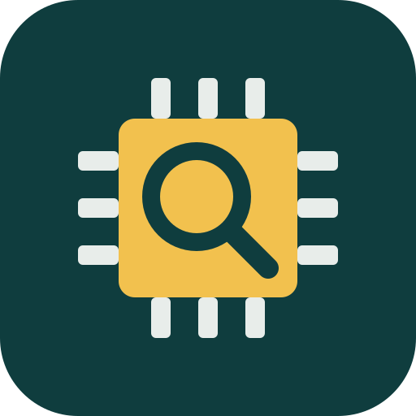

# Parts Sourcing (Digi-Key + Mouser)

A Grok Bot / Cursor plugin that searches, prices and compares electronic components across **Digi-Key** and **Mouser** side by side. It bundles a local MCP server and three skills.



## What you get

**MCP tools** (server `parts-sourcing`, local stdio, Node 18+):

| Tool | What it does |
| --- | --- |
| `search_parts` | Keyword search on both distributors, e.g. `10k resistor 0603 1%` |
| `get_part_details` | Look up one part by manufacturer or distributor part number |
| `compare_distributors` | Price at each quantity, stock, lead time, lifecycle, country of origin (when reported), datasheet; flags single-source, EOL and zero stock |
| `sourcing_status` | Shows which API keys are configured |

**Skills**

- `bom-costing`: price a BOM at build quantities and flag single-source, EOL and low-stock lines
- `find-alternates`: find drop-in candidates and list what you still need to verify
- `origin-check`: report country of origin exactly as the data gives it, with no guessing

If only one distributor's keys are set, the other is skipped with a note and everything else still works.

## Install

Install **Parts Sourcing** from the Grok Bot or Cursor plugin marketplace. To run it by hand in any MCP client:

```json
{
  "mcpServers": {
    "parts-sourcing": {
      "command": "npx",
      "args": ["-y", "github:Roo2468/parts-sourcing-plugin"],
      "env": {
        "DIGIKEY_CLIENT_ID": "...",
        "DIGIKEY_CLIENT_SECRET": "...",
        "MOUSER_API_KEY": "..."
      }
    }
  }
}
```

## API keys (bring your own)

You need your own keys. This repo stores none, and calls go straight from your machine to the distributor.

**Digi-Key** (Product Information API v4, OAuth2 client credentials)
1. Sign in at https://developer.digikey.com and create an Organization, then a Production app.
2. Add the **ProductInformation V4** API to the app.
3. Copy the Client ID and Client Secret into `DIGIKEY_CLIENT_ID` and `DIGIKEY_CLIENT_SECRET`.

**Mouser** (Search API)
1. Sign in at https://www.mouser.com/api-search/ and request a **Search API** key.
2. Put it in `MOUSER_API_KEY`.

Set them as environment variables where your agent runs (the plugin's `mcp.json` reads `${env:...}`). Optional: `DIGIKEY_LOCALE_SITE` (default `US`) and `DIGIKEY_CURRENCY` (default `USD`).

## Examples

- "Find a 10k 0603 1% resistor in stock at both Digi-Key and Mouser."
- "Compare RC0603FR-0710KL at 100 and 1000 pieces."
- "Price this BOM at 10, 100 and 500 boards and flag risky lines." (attach a CSV)
- "Find a second source for this nRF52840 module."
- "What country of origin do the distributors report for these parts?"

## Data notes

- Prices are list prices at query time, before tax, shipping and tariffs.
- Digi-Key's v4 API doesn't return country of origin. Mouser returns it only for some parts. The tools report `null` with a note and never guess.
- Mouser leaves lifecycle blank for most active parts. Blank means "not stated".
- Lead times come straight from each distributor: Digi-Key reports manufacturer lead weeks and Mouser reports its own lead-time text.

## Development

```bash
npm install
npm test                 # offline unit tests
MOUSER_API_KEY=... DIGIKEY_CLIENT_ID=... DIGIKEY_CLIENT_SECRET=... npm run live   # live smoke test over stdio
```

## License

MIT © Liminal Photonics
